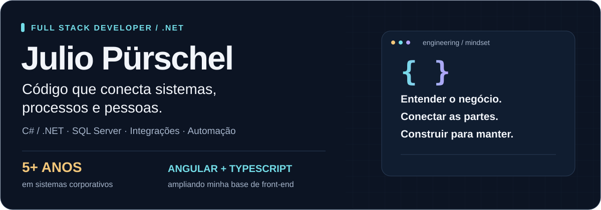
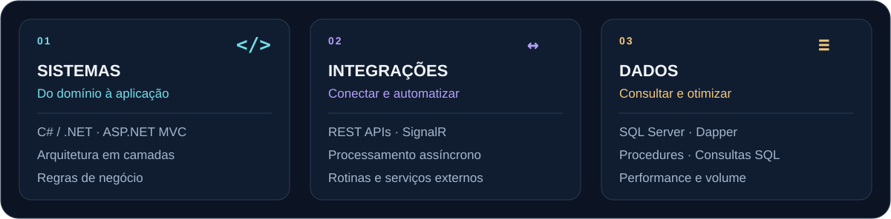
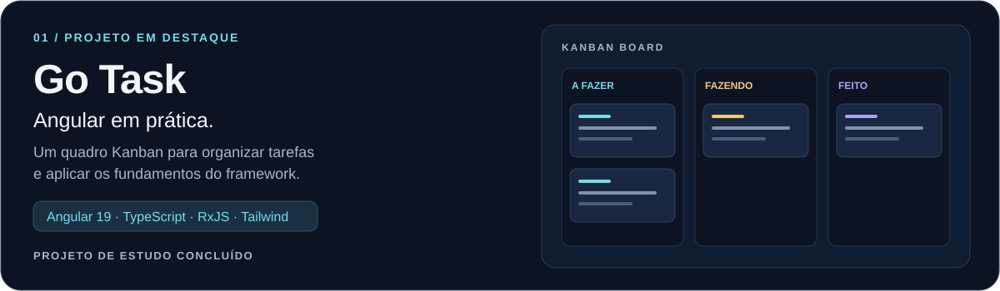
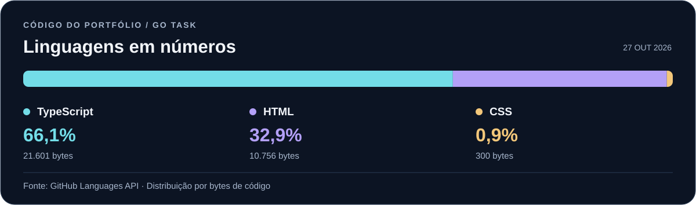

  

  <a href="https://www.linkedin.com/in/julio-purschel-308b0a10b/"><strong>LinkedIn ↗</strong></a>
  &nbsp;&nbsp;·&nbsp;&nbsp;
  <a href="https://github.com/juliopurschel/projeto-go-task"><strong>Explore o Go Task ↗</strong></a>
  &nbsp;&nbsp;·&nbsp;&nbsp;
  <a href="#tecnologias"><strong>Tecnologias ↓</strong></a>

## Software conectado ao negócio

Sou **desenvolvedor Full Stack Pleno**, com **mais de 5 anos de experiência** no desenvolvimento, manutenção e evolução de sistemas corporativos. Minha base é **C#/.NET, ASP.NET MVC, SQL Server e Dapper**, com atuação em soluções fiscais, contábeis e de gestão documental.

No dia a dia, trabalho com integrações entre sistemas, automação de processos, processamento assíncrono e otimização de consultas e rotinas de banco de dados. Gosto de entender a regra de negócio antes de escrever o código e de evoluir aplicações com atenção à estabilidade e à manutenção.

  

### Onde concentro minha experiência

- **Sistemas corporativos:** aplicações web em .NET, regras de negócio fiscais e contábeis e fluxos de gestão documental.
- **Integrações e automação:** comunicação com serviços externos, validação e importação de arquivos e execução de rotinas operacionais.
- **Dados e performance:** consultas SQL complexas, procedures, acesso a dados com Dapper e processamento de grandes volumes de informação.
- **Evolução de aplicações:** arquitetura em camadas, separação de responsabilidades, processamento assíncrono e manutenção de sistemas legados.

## Tecnologias

| Área | Tecnologias e práticas |
| :--- | :--- |
| **Back-end** | C# · .NET · ASP.NET MVC · ASP.NET Core · REST APIs · SignalR |
| **Dados** | SQL Server · Dapper · SQL · Stored Procedures · Otimização de consultas |
| **Front-end profissional** | JavaScript · jQuery · Bootstrap · AdminLTE · DataTables |
| **Automação e desktop** | Windows Forms · Selenium · Appium · Processamento assíncrono |
| **Entrega e ambiente** | Git · GitLab · CI/CD · IIS · Windows Server |
| **Fundamentos** | Arquitetura em camadas · SOLID · Clean Code · Design Patterns |
| **Em estudo** | Angular · TypeScript · RxJS · Tailwind CSS |

## Projeto em destaque

**[Go Task — organização de tarefas com Angular](https://github.com/juliopurschel/projeto-go-task)**

Projeto de estudo concluído, desenvolvido para praticar a construção de uma aplicação Angular com componentes standalone, formulários reativos e estado compartilhado por serviços.

**Na prática:** criação, edição e exclusão de tarefas; quadro Kanban com drag and drop usando Angular CDK; modais; comentários; integração com `localStorage`.

**Conceitos aplicados:** `@if`, `@for`, `@let`, injeção de dependências com `inject()`, validação de formulários, `BehaviorSubject`, observables e `AsyncPipe`.

As decisões de implementação, instruções de execução e limitações da versão estão documentadas no **[README do projeto](https://github.com/juliopurschel/projeto-go-task#readme)**.

### Linguagens do Go Task

  

Fonte: <a href="https://api.github.com/repos/juliopurschel/projeto-go-task/languages">GitHub Languages API</a> · Dados de 27/10/2026, medidos em bytes de código. O gráfico representa este projeto público; minha experiência profissional com .NET está descrita acima.

## Aprendizado e formação

Estou ampliando minha base de front-end com **Angular e TypeScript**, aplicando os conceitos em projetos de portfólio. Também estudo arquitetura de software, separação de responsabilidades e decisões que facilitam a manutenção das aplicações.

Utilizo ferramentas de IA como apoio à análise de código, implementação, revisão e documentação, com validação técnica das soluções.

**Sistemas de Informação · Universidade Potiguar · 2015–2019**

---

  <strong>Vamos conversar sobre desenvolvimento .NET?</strong> 
  <a href="https://www.linkedin.com/in/julio-purschel-308b0a10b/">Minha trajetória e contato no LinkedIn ↗</a>

